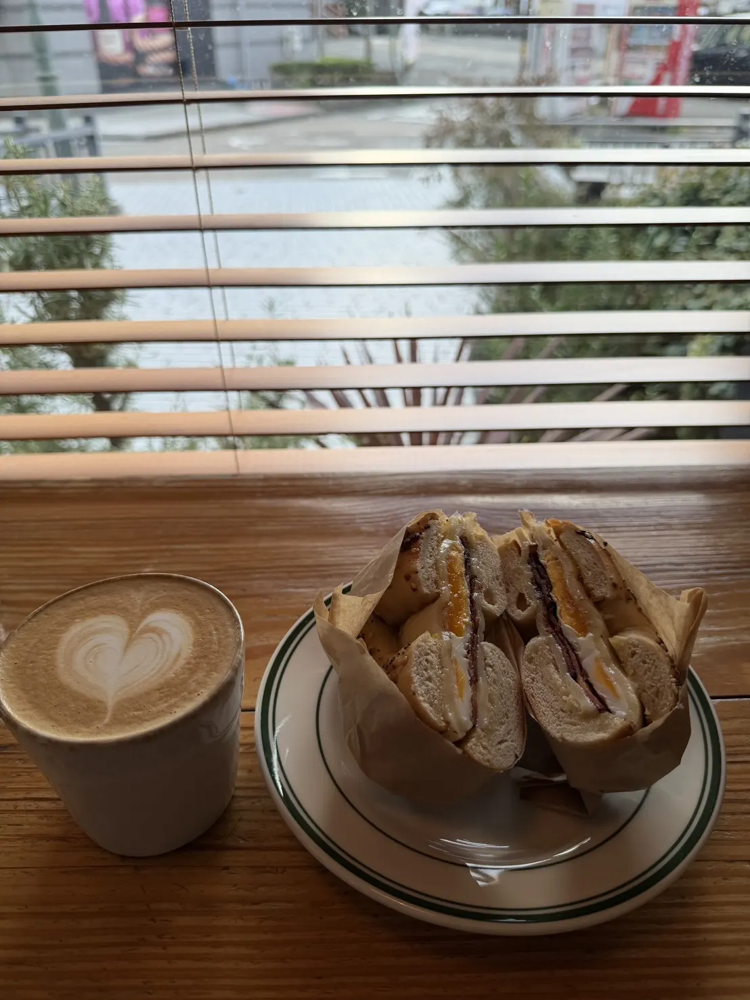
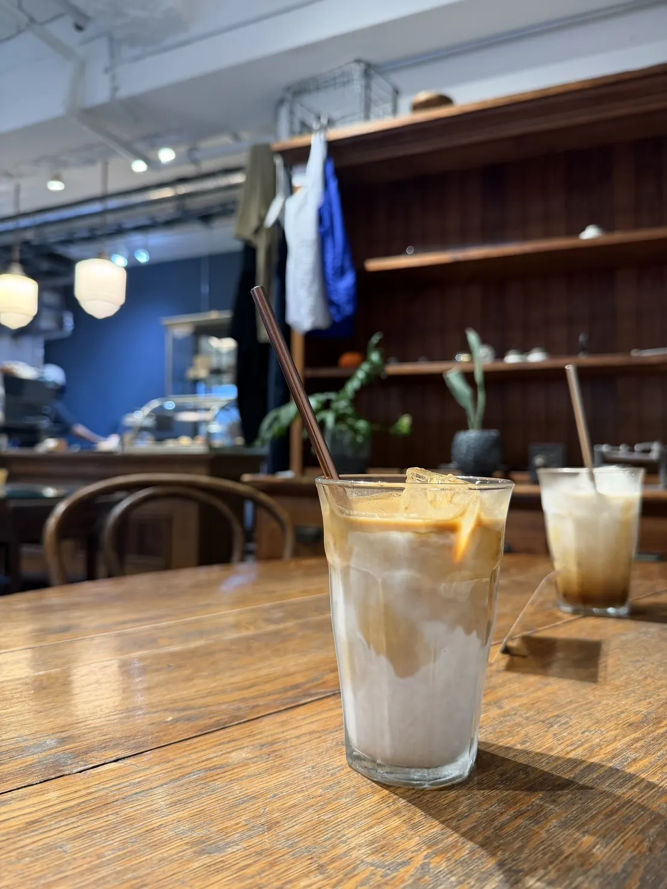

Kanazawa has plenty of famous cafés, the kind with a line out the door and a matcha parfait on every table. This list is not about those. These are small, independent places where locals actually sit down, and where you can order without pointing and hoping for the best.

All three are independent, all three have menus you can read in English, and all three are within walking distance of Korinbo, so you could visit them in one day: breakfast at one, lunch at another, an afternoon coffee at the third.

## 1. Kissa Bongo: a record café on the fifth floor

You would walk right past Kissa Bongo if nobody told you about it. It is on the fifth floor of an ordinary building in Kakinokibatake, a few minutes from Korinbo, and you have to know to go up.

I went on a clear afternoon, and the room was full of sunlight. Tall windows run along it, and you look straight out over the buildings of central Kanazawa.

The room itself is like nowhere else I know in the city. The ceiling is covered in dark green paper, dried flowers hang over the counter, and there are wicker armchairs and a wicker sofa by the windows. Along one wall is a long counter with high stools, and behind it, shelf after shelf of vinyl records, with two turntables and a mixer set up in the middle.

During the day it is a *kissa*, a Japanese-style café. In the evening the same room turns into a music bar, which explains the shelves of gin and whisky bottles behind the counter.

I ordered a hot sandwich and an iced coffee. The hot sandwich was ¥900, and the two together came to ¥1,420. The sandwich was really good, with a soft-boiled egg inside. The iced coffee was smooth, easy to drink and tasty too.

### Can you get by in English?

Easily. The owner is American, grew up in Japan, and speaks both English and Japanese, so you can just ask about the menu or the records in English. I think the menu had English on it as well, though I didn't look closely, and with the owner right there it hardly matters.

If you want to try a little Japanese anyway, this one works anywhere:

> **Kore o kudasai.** (koh-reh oh koo-dah-sigh) — "This one, please."

### Local tip

- **Look up.** The café is on the fifth floor, so look for the building, not a shop front at street level.
- **Day and night are different.** The café hours and the bar hours are not the same. Bongo is closed on Mondays, and it is worth checking the café's Instagram before you go.

## 2. Cafe Dumbo: Brooklyn coffee and bagels on Seseragi Street

DUMBO is a neighborhood in Brooklyn, New York, and Cafe Dumbo takes the name seriously: the beans come from Brooklyn Roasting Company, and the food is built around bagels. It is a brick-front café on Seseragi Street, a quiet street along a small canal near Korinbo.

I had a café latte and the bacon, egg and cheese bagel (about ¥850), at a counter by the window. Downstairs is small, but a steel staircase leads up to a much bigger, brighter room.

### Can you get by in English?

Yes. The menu is in English with Japanese underneath, and it is posted outside the door, so you can decide before you go in.

### Local tip

- **Weekday mornings are best** for a bagel breakfast. Online listings give different hours, so check before you go.
- Read more: [Cafe Dumbo: Brooklyn Coffee and Bagels on Kanazawa's Seseragi Street](/articles/cafe-dumbo-kanazawa/)

## 3. MORON CAFE: a big, bright café in Nagamachi

MORON CAFE is in Nagamachi, the old samurai district a short walk from Korinbo. It is one long, bright room with a high white ceiling, a clock hanging in the middle and mismatched chairs, and it opens at 9:00.

I had an iced latte (¥680). There are homemade muffins (¥550), vegan cookies and curry for lunch. One rule: if you order a baked item, each person also orders a drink.

### Can you get by in English?

Yes. The menu is in English in big letters, with small Japanese underneath, and the muffin labels are handwritten in English.

### Local tip

- **Come early for the bakes.** Several items were sold out when I went.
- Read more: [MORON CAFE: Iced Lattes and Muffins in Kanazawa's Nagamachi](/articles/moron-cafe-kanazawa/)
