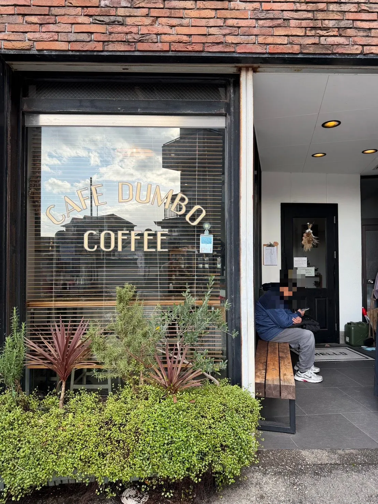
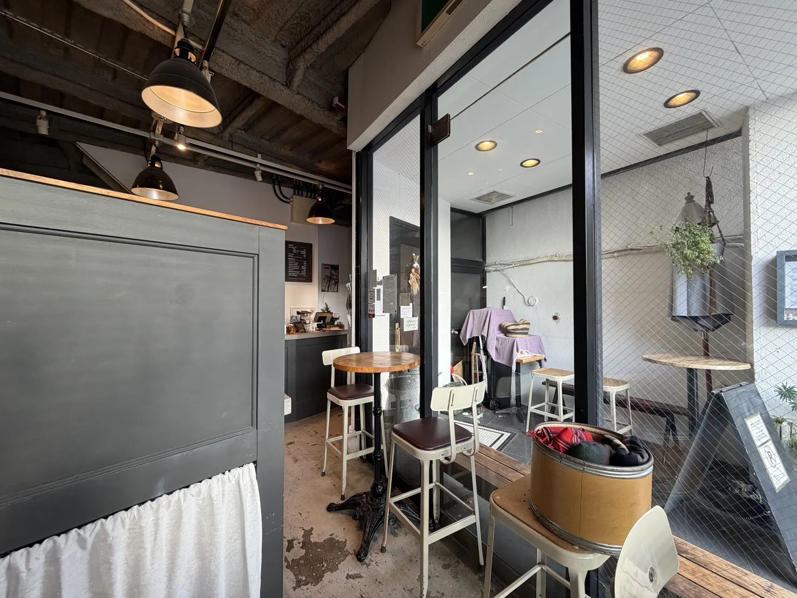
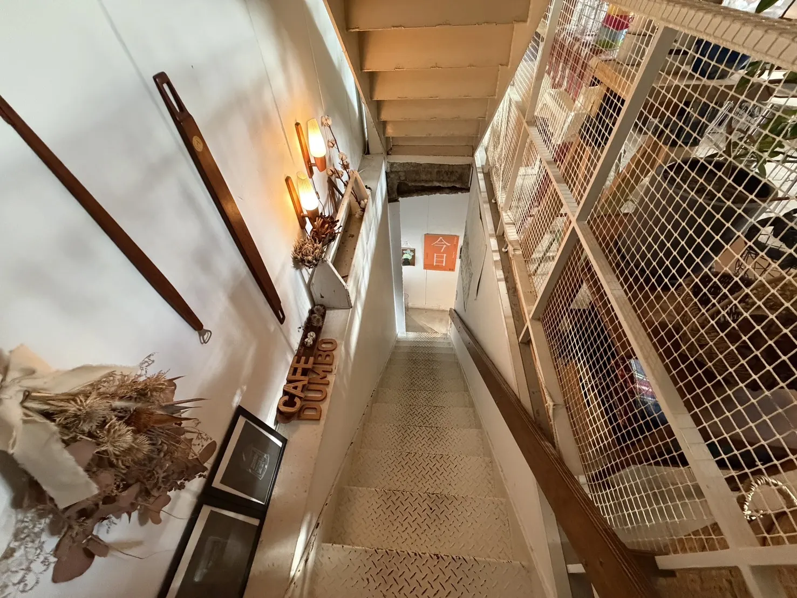
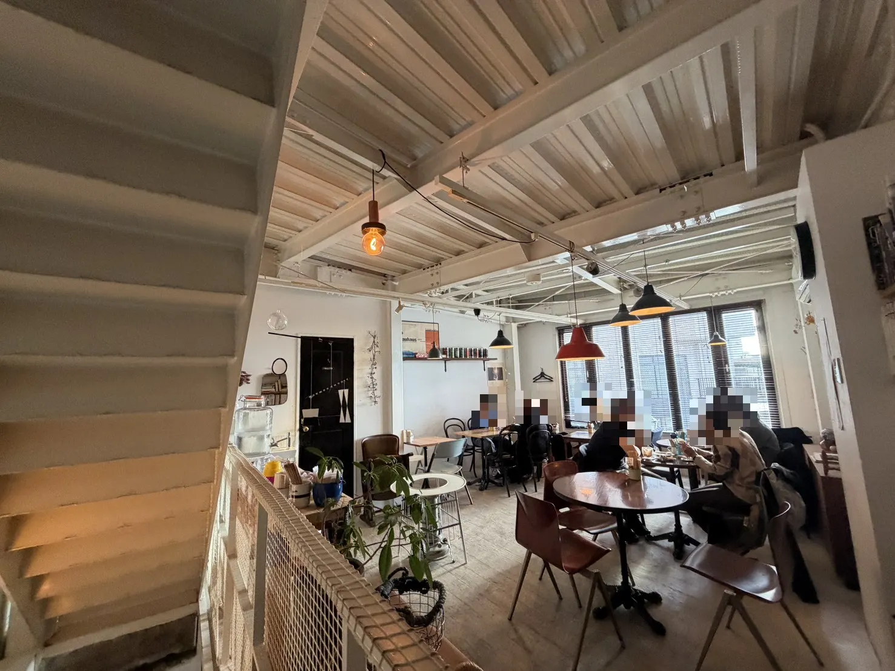
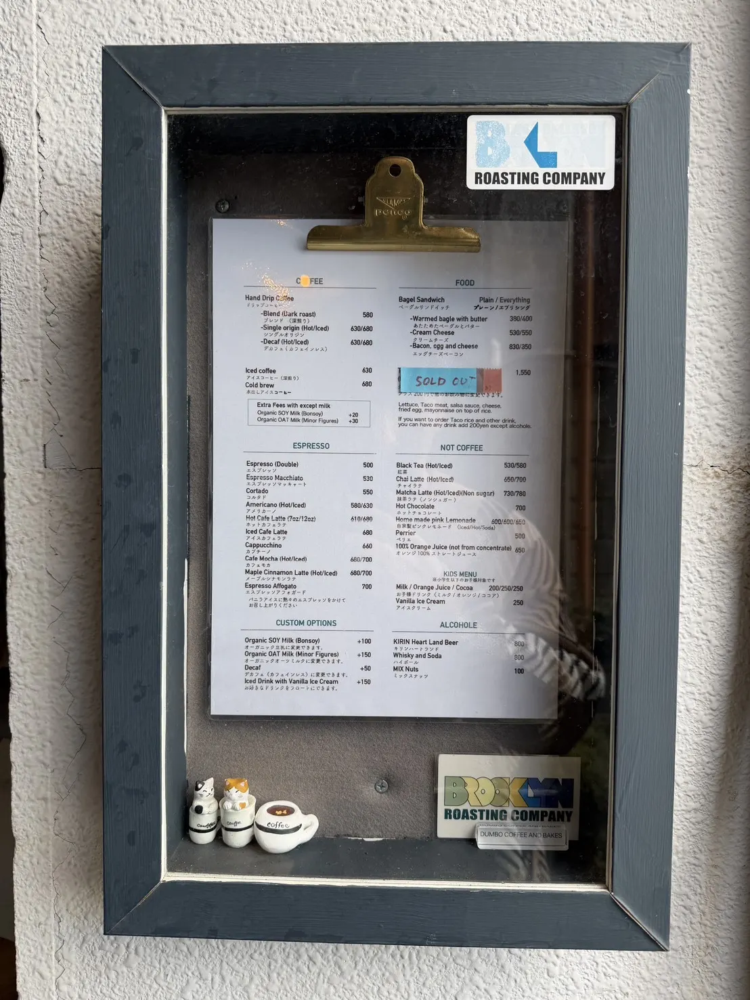

DUMBO is a neighborhood in Brooklyn, New York. Cafe Dumbo is a small café on Seseragi Street in Kanazawa, a few minutes from Korinbo, and the name is not just for show: the coffee beans come from Brooklyn Roasting Company, and the food menu is built around bagels.

It is a stylish but calm café, the kind of place to sit for a while rather than grab and go. Look for the brick wall and the gold lettering on the window. There is a wooden bench by the door and a planter full of greenery out front.

## Downstairs and upstairs

The ground floor is small: the counter, a few high tables with tall stools, and a bench along the window. It has black enamel lamps, a concrete floor and an exposed ceiling.

To find more seats, take the steel staircase. The walls along the stairs have wall lamps, dried flowers and a small wooden "CAFE DUMBO" sign.

Upstairs is a much bigger room: a white-painted ceiling, red and black pendant lamps, mismatched wooden chairs and a row of windows. When I went, on a weekday, it was mostly full. Upstairs is where I would sit if you want to relax: it is the calmest part of the café.

## What to order

I had a café latte, which was really good, and the bacon, egg and cheese bagel sandwich, at a counter by the window, looking out over the street. The bagel comes plain or "everything" (topped with seeds), and it is served cut in half in paper, so it is easy to eat.

Prices from the menu on the day I went:

| | Price |
|---|---|
| Bagel with butter (plain / everything) | ¥380 / ¥400 |
| Bagel with cream cheese | ¥530 / ¥550 |
| Bacon, egg and cheese bagel | about ¥830 / ¥850 |
| Hand drip coffee (blend) | ¥580 |
| Hot café latte (7 oz / 12 oz) | ¥610 / ¥680 |
| Maple cinnamon latte (hot / iced) | ¥680 / ¥700 |

Oat milk and soy milk are available for a small extra charge, and decaf is on the menu. There is also a short kids' menu (milk, orange juice, cocoa), plus beer and whisky with soda.

## Can you get by in English?

Yes. The menu is in English with Japanese underneath, so you can read everything and point or just say the name of the drink.

The menu is posted outside by the entrance, so you can check it before you go in. Even the notice on the stairs about seats is in English.

Most customers are Japanese (about seven in ten when I went), with travelers dropping in as they walk by, so it feels like a local café rather than a tourist spot.

If you want to try a little Japanese:

> **Kafe rate to, kore o kudasai.** (kah-feh lah-teh toh, koh-reh oh koo-dah-sigh) — "A café latte and this, please."

## Local tip

- **Check the hours before you go.** Online listings give different hours. The Seseragi Street shop listing says weekdays 8:30–18:00, weekends 11:30–18:00, closed Tuesdays and some irregular days. Weekday mornings are the time for a bagel breakfast.
- **Go upstairs.** If the ground floor looks full, there is a lot more room up the stairs.
- **Walk Seseragi Street.** The café is on a quiet street that runs along a small canal near Korinbo, with other shops and cafés nearby, so it is easy to fit into a walk downtown.
