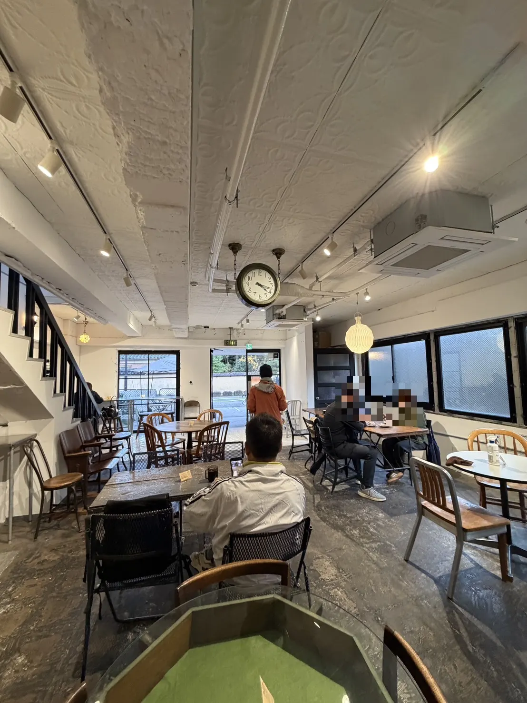
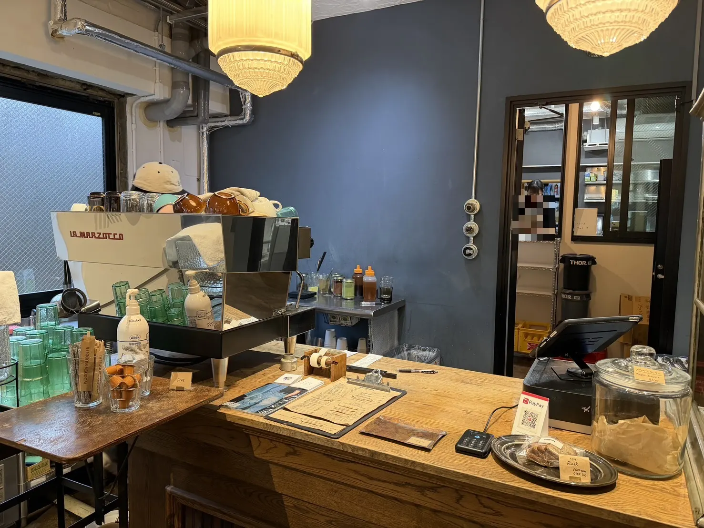
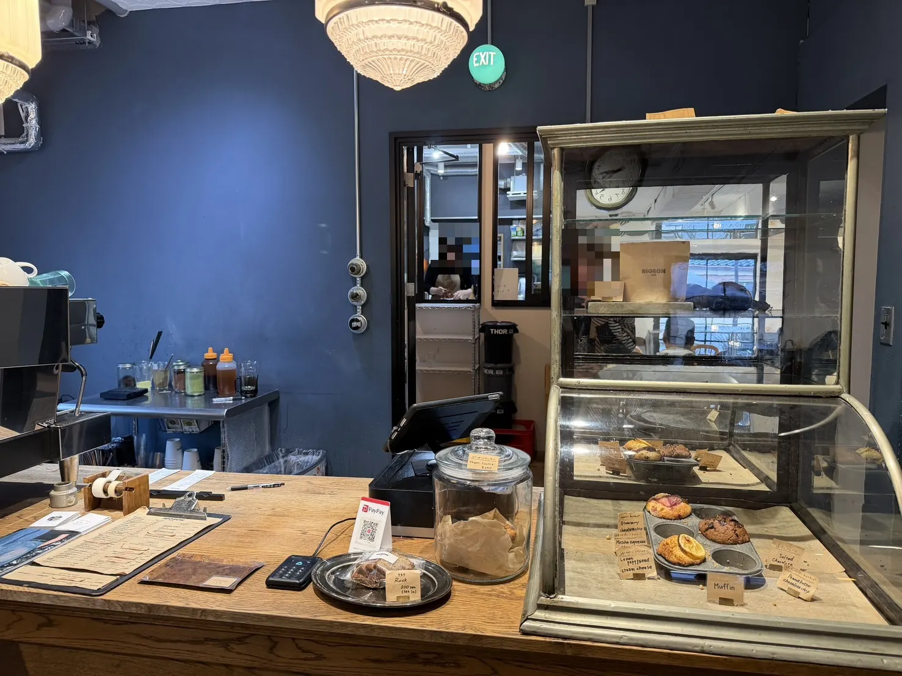
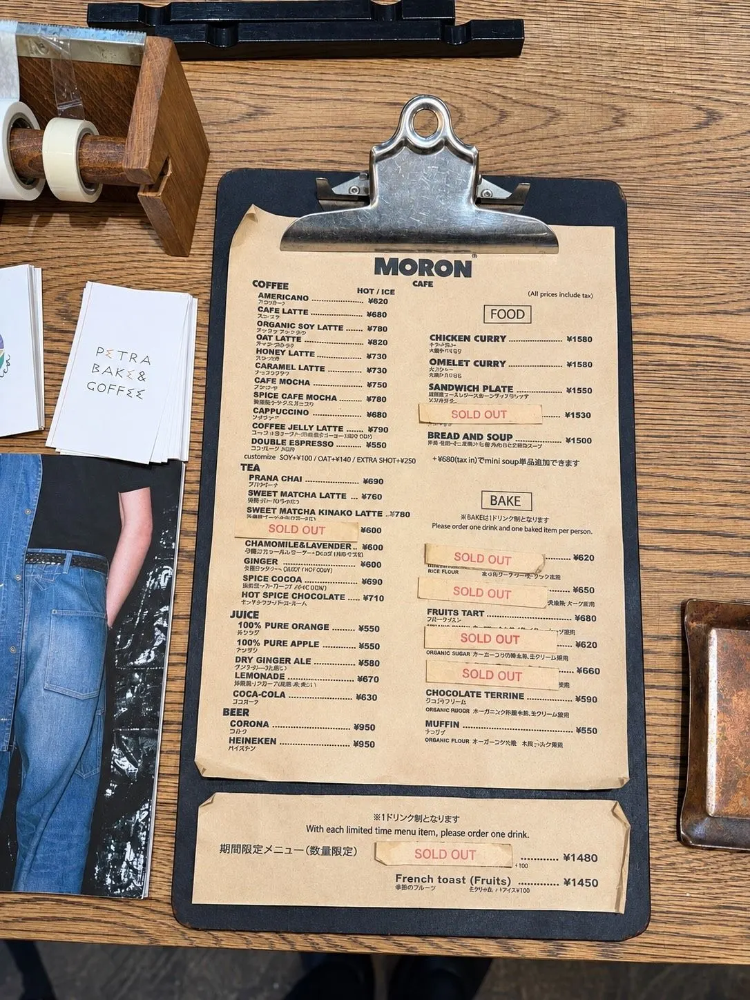

MORON CAFE is in Nagamachi, the old samurai district a short walk from Korinbo. Most cafés in this part of Kanazawa are small and quiet. This one is big: one long, bright room with a high white ceiling, a clock hanging in the middle, and windows out to the street.

The tables and chairs are all different: wooden café chairs, old metal chairs, a green glass table. There is a staircase at the back and a few seats outside by the door.

## The counter

You order and pay at the counter first. Behind it is a dark blue wall, a La Marzocco espresso machine and big glass lamps.

Next to the till is an old glass case of baked goods. On the day I went it had muffins (strawberry chocolate chip, lemon poppyseed cream cheese, matcha and others), a jar of vegan cookies (¥340) and bags of rusks (¥300).

## What to order

I had an iced café latte, and it was really good. The house blend is Colombian, Kenyan and Brazilian beans, and the espresso leans a little to the bitter side, which stands up well to the milk. The coffee menu is long:

| | Price (tax included) |
|---|---|
| Americano | ¥620 |
| Café latte | ¥680 |
| Oat latte | ¥820 |
| Honey latte / caramel latte | ¥730 |
| Coffee jelly latte | ¥790 |
| Sweet matcha latte | ¥760 |
| Muffin | ¥550 |
| Chicken curry / omelet curry | ¥1,580 |
| Sandwich plate | ¥1,550 |

You can change to soy milk (+¥100) or oat milk (+¥140), or add an extra shot (+¥250). There is also juice, and Corona and Heineken (¥950). The café also prepares vegan food, and the cookies by the till are vegan too.

**One rule to know:** if you order a baked item, each person also has to order a drink. The menu says this in English too.

## Can you get by in English?

Yes. The menu is in English in big letters, with small Japanese underneath, and the muffin labels are handwritten in English. When I went, about eight in ten customers were from overseas, so you will not be the only one ordering in English. You can pay with cash, a card or PayPay.

If you want to try a little Japanese:

> **Aisu rate o kudasai.** (eye-su lah-teh oh koo-dah-sigh) — "An iced latte, please."

## Local tip

- **Good for a morning start.** It opens at 9:00, earlier than many cafés in the area, so it works before a walk around the samurai houses in Nagamachi.
- **Check the day before you go.** The café's Instagram says it is open every day except December 31 and January 1, but some older listings say it closes on Tuesdays.
- **Popular items sell out.** Several bakes and the limited menu were already marked "sold out" when I went, so come earlier if you want a muffin.
